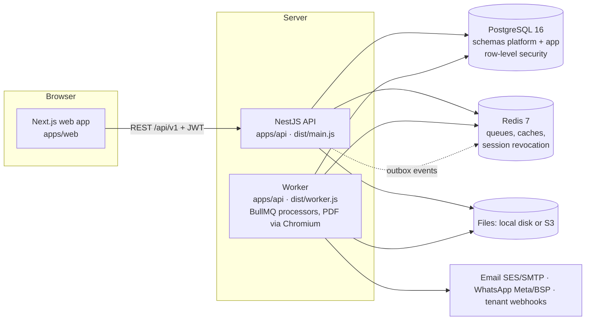

# Procure

Multi-tenant, fully configurable **procurement and inventory SaaS**. One platform serves many companies; each
company configures its own forms, masters, document types, numbering, approval workflows, permissions, notifications
and reports without any company-specific code.

What it covers:

- **Procurement:** indents → vendor quotes (with quantity slabs) → comparison → vendor selection → purchase orders
  (GST, delivery schedules, follow-ups, amendments with revisions, short-close).
- **Stores:** goods receipts through a configurable verification chain (gate → store → quality → disposition),
  returns to vendor, an append-only stock ledger with WAC or FIFO valuation, batches and expiry, transfers,
  adjustments, physical counts, issue requests, issues and returns, re-order levels.
- **Engines shared by every document type:** form builder with a safe formula language, generic masters with
  cascades, document-wise and item-wise lists, line-level quantity workflows (partial approve / hold / reject,
  parallel stages, quorum, SLA, escalation), five-level permissions (tab → button → filter → data scope → field),
  hash-chained audit log, templates and PDFs, email / WhatsApp / in-app notifications, webhooks, report builder,
  dashboards and background exports.
- **Platform console:** tenants, plans, features, limits, per-tenant overrides, usage, impersonation.

## Architecture



- **Modular monolith** (ADR-0001): one NestJS app with modules for identity, permissions, forms, documents, workflow,
  procurement, inventory, stock, templates, notify and reports. Every transaction type is a row in one generic
  `document` / `document_line` model, so all engines work on every type, including tenant-made ones.
- **Tenant isolation** (ADR-0002): every tenant table has `tenant_id` and forced row-level security; the app connects
  as `app_user` (no RLS bypass) and sets the tenant per transaction. Super Admin and sign-in use `platform_user`.
- **Ledgers:** quantities move through an append-only line ledger (`line_event`), stock through an append-only
  movement ledger (`stock_movement`); summaries are maintained in the same transaction.
- **Transactional outbox → BullMQ:** domain events are written with the business change and relayed to queues for
  notifications, webhooks, PDFs, exports and scheduled jobs.
- **Shared contracts:** `packages/schema` (Zod types used by API and web), `packages/formula` (expression language
  that runs identically in browser and server).

## Quick start

### With Docker (one command)

Requires Docker 24+ with Compose.

```bash
pnpm docker:up        # = docker compose -f infra/docker-compose.yml up --build -d
```

This builds and starts PostgreSQL 16 (host port **5433**), Redis 7 (**6380**), runs the migrations, then starts the
API on <http://localhost:4000> (health: <http://localhost:4000/health>) and the web app on <http://localhost:3000>.

Load the demo data once:

```bash
docker compose -f infra/docker-compose.yml exec api node dist/seed/demo.js
```

Stop with `pnpm docker:down`. Notes for the compose stack: background jobs run inside the API container
(`NODE_ENV=development`; add `--profile worker` and `RUN_WORKERS=off` to use the separate worker), uploads and the
`log` mail driver write to the named volumes `files` / `maillog` (`STORAGE_DIR` / `MAIL_LOG_DIR`), and the API image
ships Chromium for PDFs (see [runbook](docs/guide/runbook.md#5-storage-redis-workers-pdfs)). Every secret in the
compose file is a dev-only placeholder.

### Local development

Requires Node.js 22, pnpm 10.28 (`corepack enable`), PostgreSQL 16 and Redis 7 (or start just those two with
`docker compose -f infra/docker-compose.yml up -d postgres redis` and use ports 5433/6380 in `.env`).

```bash
cp .env.example .env     # development values only
pnpm install
pnpm db:reset            # create the database and apply all migrations (dev only)
pnpm build               # the seed runs from apps/api/dist
pnpm db:seed             # demo platform owner, plans and tenants
pnpm dev                 # API :4000 and web :3000 (watch mode)
```

Other commands: `pnpm db:migrate` (apply new migrations), `pnpm lint:rls`, `pnpm lint`, `pnpm typecheck`,
`pnpm test` (Vitest), `pnpm e2e` (Playwright; needs API and web running and seeded). Details and troubleshooting:
[docs/guides/developer-setup.md](docs/guides/developer-setup.md).

## Demo credentials

Created by the seed (`apps/api/src/seed/demo.ts`). Development only — the seed resets these passwords every run.

| Who | Where | Company code | Email | Password |
| --- | --- | --- | --- | --- |
| Super Admin (platform owner) | `/platform/login` | – | `owner@procure.local` | `Owner@12345` |
| Acme admin (all modules via overrides) | `/login` | `acme` | `admin@acme.test` | `Admin@12345` |
| Acme indent clerk (restricted, Pune Plant scope) | `/login` | `acme` | `indenter@acme.test` | `Indent@12345` |
| Acme HOD approver (restricted, Pune Plant scope) | `/login` | `acme` | `approver@acme.test` | `Approve@12345` |
| Globex admin (Starter plan, no overrides) | `/login` | `globex` | `admin@globex.test` | `Admin@12345` |

The acme demo includes a location tree (Pune Plant → Main Store → Bins A1/A2; Chennai Plant → Raw Material Store), a
custom *Capex Request* type with a three-stage workflow, an approved indent with quotes from three vendors (one with
slabs), a split vendor selection, approved POs with follow-ups, two partial GRNs through the verification chain (one
quality rejection returned to the vendor), opening stock, re-order rules, an issue request with partial issue and
return, a transfer, built-in reports and dashboards. Email and WhatsApp use the `log` providers, so nothing is really
sent.

## Repository map

| Path | What |
| --- | --- |
| `apps/api` | NestJS API and worker (`src/main.ts`, `src/worker.ts`), modules in `src/modules/*`, core (auth guard, DB, queues, errors) in `src/core`, demo seed in `src/seed`, tests in `test/` |
| `apps/web` | Next.js 15 app: tenant workspace and platform console (`src/app`), screens in `src/features/*`, form renderer / builder and formula editor in `src/engines`, shell and navigation in `src/components/shell` |
| `packages/schema` | `@procure/schema`: Zod contracts and shared types (settings registry, permissions helpers, error codes) |
| `packages/formula` | `@procure/formula`: parser, checker and evaluator of the formula language |
| `packages/ui` | `@procure/ui`: design tokens, Tailwind preset and components |
| `packages/test-kit` | Test helpers shared by API tests and E2E |
| `db/migrations` | Forward-only SQL migrations (`0001`–`0018`) |
| `db/migrate.mjs`, `db/policies` | Migration runner; RLS lint and allow-list |
| `infra/docker`, `infra/docker-compose.yml` | Container images and the local full stack |
| `infra/terraform` | AWS stack (ECS, RDS, ElastiCache, S3, ALB, alarms) for staging and production |
| `.github/workflows` | CI (lint, typecheck, build, tests, E2E, audit, Trivy, gitleaks) and Deploy |
| `e2e` | Playwright journeys |
| `load` | Load / performance scripts and results |
| `scripts` | Local service helpers |
| `docs/guide` | **Product documentation** (start here) |
| `docs/contracts`, `docs/adr`, `docs/qa` | API contracts per phase, architecture decisions, QA reports |

## Documentation

| Guide | For |
| --- | --- |
| [Administrator guide](docs/guide/admin-guide.md) | Super Admin and Tenant Admin: tenants, plans, users, permissions, forms, workflows, notifications, reports, stock rules |
| [User guide](docs/guide/user-guide.md) | Everyday journeys: indent to PO, GRN chain, stock, issues, approvals, reports |
| [Settings reference](docs/guide/settings-reference.md) | Every tenant setting with type, default and effect |
| [Permissions reference](docs/guide/permissions-reference.md) | Every permission key with label, feature and the endpoints that check it |
| [API guide](docs/guide/api.md) | Auth, tenancy, errors, pagination, versioning, idempotency, webhooks, endpoint index |
| [Runbook](docs/guide/runbook.md) | Deployment, configuration, scaling, backups, jobs, monitoring, incident playbooks, upgrades |
| [Data model](docs/guide/data-model.md) | Tables, quantity and stock ledgers, row-level security |
| [Developer setup](docs/guides/developer-setup.md) | Running and testing the monorepo locally |
