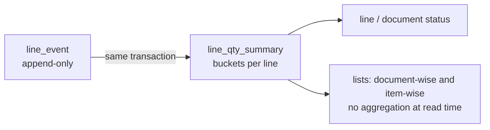

# Data model

PostgreSQL 16. Schema is created by the forward-only migrations in [`db/migrations`](../../db/migrations)
(`0001`–`0018`), applied by `db/migrate.mjs` as the owner role. Design decisions: ADR-0001 (generic documents),
ADR-0002 (RLS, two roles), ADR-0006 (generic master records), ADR-0010 (quantity ledger), ADR-0011 (workflow),
ADR-0012 (outbox), ADR-0016 (stock ledger).

Conventions:

- Primary keys are time-ordered UUID v7 (`app.uuid_v7()`); ledgers use `bigserial` ids.
- Quantities are `numeric(18,4)`; the API handles them as decimal strings and integer units of 1/10,000 (never floats).
- Editable rows carry `version` (incremented by the `touch_updated_at` trigger) for optimistic locking, plus
  `created_*`, `updated_*` and soft-delete `is_deleted`.
- Append-only tables have `UPDATE` and `DELETE` revoked from the application roles: `app.audit_log`,
  `app.form_version`, `app.line_event`, `app.wf_action`, `app.workflow_version`, `app.stock_movement`.

## Schemas and roles

```mermaid
flowchart LR
  subgraph DB[PostgreSQL database "procure"]
    P[(schema platform\ncross-tenant)]
    A[(schema app\ntenant tables, FORCE RLS)]
  end
  M[postgres / migrator\nowner, runs migrations] --> P & A
  PU[platform_user\nBYPASSRLS] --> P & A
  AU[app_user\nNOBYPASSRLS] --> A
  AU -. SECURITY DEFINER functions .-> P
```

| Role | Used by | Can see |
| --- | --- | --- |
| `postgres` (migrator; `DATABASE_MIGRATOR_URL`) | `db/migrate.mjs`, `rls-lint.mjs` | Everything; owns all objects. Never used by the running app. |
| `app_user` (`DATABASE_URL`) | All tenant traffic (`DbService.tenantTx`) | Only `app.*` rows of the tenant set in `app.tenant_id`. Reads its own plan through `SECURITY DEFINER` functions (`app.my_features()`, `app.my_limit()`, `app.my_tenant_state()`, `app.consume_quota()`, `app.consume_storage()`, `app.lock_tenant_for_limit()`, `app.platform_permission_defs()`, `app.my_whatsapp_templates()`). |
| `platform_user` (`DATABASE_PLATFORM_URL`) | Super Admin, sign-in/refresh, outbox relay, audit verification, seed | `platform.*` and, bypassing RLS, `app.*` (code filters by tenant explicitly). ESLint restricts its use to `modules/platform`, `modules/identity`, `core` and `seed`. |

Migration `0001` creates `app_user` / `platform_user` with **development passwords** (`app_pass`, `platform_pass`);
production sets real passwords after the first migration (see the [runbook](runbook.md#database-roles)).

## Row-level security

Every table in schema `app` has `tenant_id uuid NOT NULL DEFAULT app.current_tenant_id()` and is set up with
`SELECT app.enable_tenant_rls('app.<table>')`, which:

1. `ENABLE` and `FORCE ROW LEVEL SECURITY` (the owner is subject to it too);
2. creates policy `tenant_isolation`: `USING (tenant_id = app.current_tenant_id()) WITH CHECK (same)`.

`app.current_tenant_id()` reads `current_setting('app.tenant_id')`. `DbService.tenantTx(tenantId, fn)` opens a
transaction and runs `set_config('app.tenant_id', <uuid>, true)` (transaction-local) before `fn`. With no context the
function returns NULL, every predicate is false and queries return **zero rows** (fail closed). Writing a row for
another tenant fails the `WITH CHECK` (`new row violates row-level security policy`); production logs that message to
the `RlsViolations` metric, which pages.

`pnpm lint:rls` (`db/policies/rls-lint.mjs`) fails CI if any `app.*` table lacks `tenant_id`, FORCE RLS or the
policy; deliberate exceptions go in `db/policies/rls-allowlist.json`.

Under FORCE RLS the GIN indexes on JSONB (`@>`) and full text (`@@`) cannot serve as index conditions for `app_user`
(the operators are not LEAKPROOF; ADR-0009). Hot JSON keys should get b-tree expression indexes instead.

## Platform tables (`platform.*`)

| Table | Purpose |
| --- | --- |
| `feature_catalog`, `limit_catalog` | The plan features and limits that exist (seeded by `0004`). |
| `plan`, `plan_feature`, `plan_limit` | Plans and their contents. Limit `NULL` = unlimited. |
| `tenant` | Tenants: code, name, status (`active` / `suspended` / `archived`), profile (legal name, GSTIN, PAN, address, logo, timezone, currency, `fy_start_month`). |
| `subscription` | Subscription history; one open row (`effective_to IS NULL`) per tenant; status `trial` / `active` / `grace` / `expired` / `suspended`. |
| `tenant_override`, `tenant_override_history` | Per-tenant feature/limit overrides with reasons and full history. |
| `usage_meter` | Metered usage per tenant, limit and period (`YYYY-MM` in tenant time, or `lifetime`). |
| `platform_user` | Super Admin team (`owner`, `support`, `billing`). |
| `auth_session` | Sessions of both audiences; refresh token stored as sha256; rotation family; revocation. |
| `audit_log` | Platform audit log, hash-chained (`prev_hash`, `hash`, `hash_alg`). |
| `audit_check` | Results of audit-chain verifications (per tenant and platform). |
| `global_template` | Provisioning bundles (`standard`) copied into new tenants. |
| `permission_def` | Shipped permission registry (83 keys). |
| `provider_credential` | Email / WhatsApp providers (platform default and per-tenant), secrets AES-256-GCM encrypted with `PROVIDER_KEY`. |
| `whatsapp_template`, `tenant_whatsapp_template` | WhatsApp template catalogue and the per-tenant allow-list. |

## Tenant tables (`app.*`)

| Area | Tables | Notes |
| --- | --- | --- |
| Identity | `tenant_user`, `role`, `user_role`, `tenant_setting`, `notification`, `audit_log` | `audit_log` is hash-chained per tenant and append-only. `tenant_setting` holds changed settings and `labels.<lang>`. |
| Permissions | `permission_def`, `permission_grant`, `scope_grant`, `field_access` | Generated keys; role/user grants (`allow` / `deny`); data scope (node + include descendants, optional per tab); per-field access. |
| Locations | `location_node` | Unlimited tree; `ltree` path; scope queries use `path <@ ANY(paths)`. |
| Forms and masters | `form_def`, `form_version`, `master_def`, `master_record`, `record_ref`, `file_object` | Every master's records in one table: real columns `code`, `name`, `is_active`; everything else in `data` JSONB validated against the record's form version. `record_ref` indexes every reference (delete protection, "where used"). |
| Documents | `doc_type`, `numbering_series`, `numbering_counter`, `document`, `document_line`, `line_event`, `line_qty_summary`, `line_link`, `comment`, `attachment`, `saved_view`, `outbox_event` | See below. |
| Workflow | `workflow_def`, `workflow_version`, `wf_instance`, `wf_stage_state`, `wf_line_state`, `wf_action`, `wf_assignment` | See below. |
| Procurement | `vendor_quote`, `po_followup`, `document_revision`, `line_tax` | Quote log with versions and slabs; follow-ups; PO revision snapshots; GST split per PO line. |
| Notify and templates | `message_template`, `trigger_rule`, `outbound_message`, `generated_pdf`, `webhook_endpoint`, `webhook_delivery` | PDF cache keyed by document version, template version and field-access variant. |
| Reports | `report_def`, `report_schedule`, `dashboard_def`, `export_job` | |
| Stock | `stock_batch`, `stock_movement`, `stock_balance`, `item_avg_cost`, `valuation_layer`, `reorder_rule` | See below. |

### Documents

Every transaction type, built-in or tenant-made, is a row in `app.doc_type` (header form, optional line form,
settings, `kind = system | custom`) and its documents live in `app.document` / `app.document_line`.

- **System fields are columns** (`location_node_id`, `doc_date`, `required_by`, `party_id`, `currency`,
  `total_amount`; on lines `item_id`, `uom_id`, `qty`, `rate`, `amount`, `required_date`, `location_node_id`);
  all other fields are in `custom` JSONB, validated against the form version stored on the row.
- `number` is NULL until submit, then assigned from the most specific active numbering series (the document's
  location or nearest ancestor, else the all-locations series) with `UPDATE numbering_counter … RETURNING`, so
  concurrent submits never collide or skip. Unique per tenant + type.
- `status_key` (document and line) is derived from the ledger and workflow state: `draft`, `waiting_<stage>`,
  `on_hold`, `partially_approved`, `approved`, `rejected`, `cancelled`, `closed`, plus module statuses
  (`amending` for POs; `partially_received`, `received` for POs once goods receipts start).
- Lines repeat `doc_type_id` and location so item-wise lists need no join; dedicated indexes serve both list views
  (`document_list*`, `document_line_itemwise*`).
- `app.outbox_event` receives domain events in the same transaction as the change (ADR-0012).

### Quantity ledger

Quantities of a line never change by update after submit. Every quantity-changing action appends a row to
**`app.line_event`** (append-only), and **`app.line_qty_summary`** (one row per line) is updated in the same
transaction under a row lock (`SELECT … FOR UPDATE` in line-id order).



| Event | Bucket | Sign | Written when |
| --- | --- | --- | --- |
| `requested` | requested | + | Document submitted (each line's qty) |
| `approved` | approved | + | Quantity leaves the last workflow stage approved (or auto-approve with no runnable stage) |
| `held` / `unheld` | held | + / − | Hold / un-hold at a stage |
| `rejected` | rejected | + | Rejected at a stage (including the remainder of a reduction) |
| `cancelled` | cancelled | + | Line or document cancelled; send back to draft |
| `short_closed` | short_closed | + | Indent or PO line short-closed |
| `over_approved` / `over_approval_cancelled` | over_approved | + / − | Vendor selection above the approved qty (and its reversal) |
| `selected` / `selection_cancelled` | selected | + / − | Vendor selection submitted / its quantity rejected or reduced |
| `ordered` / `order_cancelled` | ordered | + / − | PO submitted (on the source indent and selection lines) / PO line rejected, cancelled or reduced |
| `received` | received | + | GRN submitted (on PO lines and their indent lines) |
| `accepted` | accepted | + | GRN quantity posted into stock |
| `rejected_at_receipt` | rejected_at_receipt | + | GRN quantity rejected before it entered stock (re-opens the PO line) |
| `issued` | issued | + | Store issue against an issue request line |
| `returned` | returned | + | Store return (on issue lines); return to vendor (on PO lines) |

Derived figures (computed, not stored):

| Figure | Formula |
| --- | --- |
| Pending approval | requested − approved − rejected − cancelled (includes held) |
| Pending order | approved + over_approved − ordered − short_closed |
| Pending receipt | ordered − received + rejected_at_receipt (+ returned when `rtv.reopens_po` is on) |
| Selectable (indent line) | approved + over_approved − selected − short_closed |

Invariants enforced on every event: no bucket below zero, and
`approved + rejected + cancelled ≤ requested + over_approved` (`409 QTY_INVARIANT` otherwise). Concurrent consumers of
the same remaining quantity (two buyers ordering the same indent line) lock the summary rows, so exactly one succeeds
and the other gets `409 QTY_EXCEEDS_REMAINING`.

`app.line_link` records hand-offs between lines (indent line → selection line `selected`, → PO line `ordered`, and so
on) with quantities, for traceability and reports.

### Workflow runtime

| Table | Holds |
| --- | --- |
| `workflow_def` / `workflow_version` | Draft and immutable published versions per document type. Running documents finish on their version. |
| `wf_instance` | One running instance per document (unique index); `running` / `completed` / `cancelled`. |
| `wf_stage_state` | Per stage: `pending` / `active` / `done` / `skipped` (with reason) / `disabled`; SLA `due_at`, `next_reminder_at`, `escalated_at`. |
| `wf_line_state` | Quantity sitting at each stage for each line (`pending_qty`, `held_qty`). One line can be split across stages. Sum over stages of pending + held = quantity still in the workflow. |
| `wf_action` | Append-only log of every action with per-line decisions; unique `idempotency_key`. |
| `wf_assignment` | Extra assignees from forward and SLA escalation. |

### Stock ledger

Stock changes **only** through `StockLedger.post(...)` (ADR-0016), which in one transaction locks the affected
balance rows in key order, values the movement, appends to the ledger and updates balances and cost tables.

```mermaid
flowchart TD
  WF[workflow effect\npost_stock / block_stock / unblock_stock\nor opening / block API] --> P[StockLedger.post]
  P --> M[stock_movement\nappend-only, idempotency_key]
  P --> B[stock_balance\nitem × node × batch × status]
  P --> C[item_avg_cost (WAC)\nvaluation_layer (FIFO)]
  P --> O[outbox: stock.moved\nre-order check → stock.below_min]
```

| Table | Key | Holds |
| --- | --- | --- |
| `stock_movement` | `id` | One row per change: item, node, batch, `stock_status` (`available` / `quarantine` / `rejected`), `movement_type`, `qty_in` **or** `qty_out`, `unit_cost`, signed `value`, source document/line, `pair_id`, reason, actor, `idempotency_key` (unique per tenant). |
| `stock_balance` | tenant, item, node, `batch_key`, status | Current qty and value. `batch_key` is the batch id or the zero UUID for non-batch items. |
| `item_avg_cost` | tenant, item, node | Qty, value and weighted average cost per item × location. |
| `valuation_layer` | `id` | FIFO layers: each receipt opens a layer; outs consume oldest first (`qty_left`). |
| `stock_batch` | tenant, item, `batch_no` | Batch with manufacturing and expiry dates, vendor. |
| `reorder_rule` | tenant, item, node | `min_qty`, `reorder_qty`, `max_qty`, `auto_indent`, alert throttle. |

Movement types: `opening`, `receipt`, `issue`, `return`, `transfer_out` / `transfer_in`, `adjustment_in` /
`adjustment_out`, `block` / `unblock`, `reject`, `rtv`, `count_in` / `count_out`, `reversal`.

- **Paired movements.** Status changes (block, unblock, reject) and transfers write two rows (out of one bucket or
  location, into another) sharing a `pair_id`; transfers carry the source cost.
- **Valuation.** Outs are valued by the ledger, never by the caller: WAC uses `item_avg_cost` of the node; FIFO
  consumes `valuation_layer`. The method (`stock.valuation`) is fixed per financial year.
- **Negative stock** is refused (`409 STOCK_NEGATIVE`) unless `stock.allow_negative` is on.
- **Corrections** are new `reversal` rows; history is never edited.
- **Drift check.** Nightly (02:50 UTC) the `stock-drift` job samples up to 500 balance rows per tenant, recomputes
  qty and value from `stock_movement`, checks `item_avg_cost` and FIFO layers, and on any difference logs an error,
  emits `stock.drift_detected` and notifies the tenant admins. It never repairs data
  (see [runbook](runbook.md#ledger-drift)).

## Audit chain

Each tenant's `app.audit_log` and the platform `platform.audit_log` are hash chains: every row stores `prev_hash`
and `hash = HMAC-SHA256(AUDIT_HASH_KEY, prev_hash + canonical row)`, written under an advisory lock so rows chain in
order. `hash_alg` (migration 0022) names the algorithm per row: `hmac-sha256` for new rows, `sha256` (plain hash) for
rows written before 0022, which verify only ahead of the chain's first keyed row (SEC8-015). The nightly
`audit-verify` job (02:30 UTC) and `POST /audit/checks` recompute the chain and store a `platform.audit_check` row;
a break names the first bad row id.
