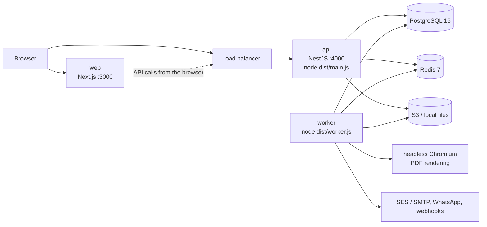

# Operations runbook

How to deploy, run, watch and repair Procure. AWS specifics (ECS, RDS, ElastiCache, S3, Secrets Manager) follow
`infra/terraform` and `.github/workflows/deploy.yml`; the same procedures apply to any host that runs the three
containers. This guide supersedes the Phase 1 draft in [`docs/guides/runbook.md`](../guides/runbook.md); that file
still has the detailed AWS CLI commands for rollback, PITR restore and environment bootstrap, referenced below.

## 1. Components



| Process | Image | Command | Notes |
| --- | --- | --- | --- |
| api | `infra/docker/api.Dockerfile` | `node dist/main.js` | Stateless HTTP API. Health check `GET /health`. With `RUN_WORKERS=inline` it also runs the background processors. |
| worker | `infra/docker/worker.Dockerfile` (built on the api image) | `node dist/worker.js` | Same module graph, no HTTP; runs every BullMQ processor and registers the repeatable jobs. |
| web | `infra/docker/web.Dockerfile` | `node apps/web/server.js` | Next.js standalone. `NEXT_PUBLIC_API_URL` is baked in at build time, so build one image per environment. |
| migrate | api image | `node db/migrate.mjs && node db/policies/rls-lint.mjs` | One-off task before each rollout. |

## 2. Environment variables

API and worker read their configuration once at start (`apps/api/src/core/config.ts`, validated with Zod: a bad value
stops the process). The table lists every variable the code reads.

| Variable | Required | Default | Used by | Meaning |
| --- | --- | --- | --- | --- |
| `NODE_ENV` | no | `development` | api, worker | `development`, `test` or `production`. Production makes cookies secure, requires `FILE_URL_SECRET`, `PROVIDER_KEY` and `AUDIT_HASH_KEY`, and defaults `RUN_WORKERS` to `off`. |
| `API_PORT` | no | `4000` | api | HTTP port. |
| `DATABASE_URL` | **yes** | – | api, worker | Connection string for role `app_user` (tenant traffic). |
| `DATABASE_PLATFORM_URL` | **yes** | – | api, worker, seed | Connection string for role `platform_user`. |
| `DATABASE_MIGRATOR_URL` | for migrations | `postgres://postgres@localhost:5432/procure` | `db/migrate.mjs`, `rls-lint.mjs`, load scripts | Owner role. Never given to api/worker. |
| `RLS_LINT_APP_ROLE` | no | `app_user` | `rls-lint.mjs` | Role the RLS lint checks. |
| `DB_POOL_SIZE` | no | `20` (min 2) | api, worker | Connections per pool (there are two pools per process). |
| `REDIS_URL` | no | `redis://localhost:6379` | api, worker, seed | Redis (use `rediss://` for TLS). |
| `JWT_SECRET` | **yes** | – | api, worker | HS256 signing key, at least 32 characters. Also the fallback seed for `FILE_URL_SECRET`, `PROVIDER_KEY` and `AUDIT_HASH_KEY` outside production. |
| `JWT_SECRET_PREVIOUS` | no | – | api | Old key, accepted for **verification only** during a rotation (min 32 chars). |
| `ACCESS_TOKEN_TTL_SEC` | no | `900` | api | Access-token lifetime. |
| `WEB_ORIGIN` | no | `http://localhost:3000` | api | Allowed CORS origin(s), comma-separated, with credentials. |
| `COOKIE_SECURE` | no | `false` | api | `true` adds `Secure` to the refresh cookie (always on in production). |
| `RATE_LIMIT` | no | on (off under `test`) | api | `on` / `off`. |
| `RUN_WORKERS` | no | `inline` (dev/test), `off` (production) | api | `inline` runs the queue processors inside the API process; `off` leaves them to `dist/worker.js`. |
| `STORAGE_DRIVER` | no | `local` | api, worker | `local` or `s3`. |
| `STORAGE_DIR` | no | `<repo>/.data/files` | api, worker | Root for the local driver. Must be writable and shared by api and worker. |
| `S3_BUCKET` | when `s3` | – | api, worker | Bucket for files. |
| `S3_REGION` | no | `ap-south-1` | api, worker | |
| `S3_ENDPOINT` | no | – | api, worker | Custom endpoint (MinIO, LocalStack). |
| `SCANNER_DRIVER` | no | `noop` | api, worker | `noop` marks uploads clean at once (dev/test); `clamav` streams them to clamd. |
| `CLAMAV_HOST` / `CLAMAV_PORT` | no | `localhost` / `3310` | api, worker | clamd address. |
| `FILE_URL_SECRET` | **yes in production** | derived from `JWT_SECRET` | api | HMAC key for signed file URLs (min 32 chars). |
| `FILE_URL_BASE` | no | `''` (relative URLs) | api, worker | Absolute prefix for signed file URLs, e.g. `https://api.example.com`. Also whitelisted for PDF rendering. |
| `PROVIDER_KEY` | **yes in production** | derived from `JWT_SECRET` | api, worker | AES-256-GCM key for email/WhatsApp provider secrets. Any string (hashed to 32 bytes); a 64-char hex or 44-char base64 value is used as-is. |
| `AUDIT_HASH_KEY` | **yes in production** | derived from `JWT_SECRET` | api, worker, seed | HMAC-SHA256 key of the audit hash chain (`app.audit_log`, `platform.audit_log`; min 32 chars). Keep it outside the database: whoever holds it can recompute the chain. Every process that writes audit rows must use the same value. |
| `AUDIT_HASH_KEY_PREVIOUS` | no | – | api, worker | Old audit keys, comma-separated, accepted by the verifier only (rows written before a rotation). Keep them for as long as those rows are kept. |
| `MAIL_LOG_DIR` | no | `<repo>/.data/mail` | worker | Where the `log` email / WhatsApp providers write messages. |
| `PDF_CHROMIUM_PATH` | for PDFs | first `chromium-*` under `PLAYWRIGHT_BROWSERS_PATH` | worker (api when inline) | Chromium executable for PDF rendering. |
| `PLAYWRIGHT_BROWSERS_PATH` | no | – | worker | Fallback search location for Chromium. |
| `NEXT_PUBLIC_API_URL` | at web **build** | `http://localhost:4000/api/v1` | web | API base URL used by the browser. |
| `NEXT_PUBLIC_PROCUREMENT_MOCK`, `NEXT_PUBLIC_NOTIFY_MOCK`, `NEXT_PUBLIC_REPORTS_MOCK` | no | unset | web build | Development mocks. Never set in production. |
| `PROCESS_TYPE` | no | – | images | Set by the worker image / ECS task (`worker`, `api`, `web`); informational. |

`.env.example` at the repo root holds development values only.

## 3. Secrets

| Secret | Where (AWS) | Rotation |
| --- | --- | --- |
| `JWT_SECRET` | Secrets Manager `procure-<env>/jwt_secret` | Zero-downtime with `JWT_SECRET_PREVIOUS`, below |
| `DATABASE_URL`, `DATABASE_PLATFORM_URL`, `DATABASE_MIGRATOR_URL` | `procure-<env>/database_url` etc. | `ALTER ROLE … PASSWORD`, update the secret, force a new deployment |
| `REDIS_URL` | `procure-<env>/redis_url` | ElastiCache auth token rotation, then redeploy |
| `JWT_SECRET_PREVIOUS` | `procure-<env>/jwt_secret_previous` (seeded equal to `jwt_secret`) | Part of the JWT rotation below |
| `FILE_URL_SECRET` | `procure-<env>/file_url_secret` (64-char hex, generated by Terraform) | Change and redeploy; outstanding signed URLs stop working (5 min for app links; scheduled-report email links last 7 days) |
| `PROVIDER_KEY` | `procure-<env>/provider_key` (64-char hex, generated by Terraform) | No re-encryption tool exists: after changing it, re-enter every provider secret in **Super Admin → Message providers** |
| `AUDIT_HASH_KEY` | `procure-<env>/audit_hash_key` (64-char hex, generated by Terraform) | Rows are never re-hashed. Put the old value into `procure-<env>/audit_hash_key_previous` (comma-separated, keep every old key) **and** set the new `audit_hash_key`, then force a new deployment of api and worker; the verifier accepts both |
| `AUDIT_HASH_KEY_PREVIOUS` | `procure-<env>/audit_hash_key_previous` (seeded equal to `audit_hash_key`) | Part of the audit key rotation above |

Terraform injects all of the above into the api and worker tasks (ECS `secrets`), plus `STORAGE_DRIVER=s3`,
`S3_BUCKET`, `S3_REGION`, `FILE_URL_BASE=https://<api host>` and `RUN_WORKERS=off` as plain environment. Terraform
only seeds secret values (`ignore_changes`); rotations are done in Secrets Manager.

> **Environments created before this change:** Terraform ignores `container_definitions` after creation (the Deploy
> workflow registers new revisions by copying the service's current one), so the new variables reach existing
> services only after a one-time refresh: `terraform apply -var-file=<env>.tfvars
> -replace='module.stack.aws_ecs_task_definition.app["api"]' -replace='module.stack.aws_ecs_task_definition.app["worker"]'`,
> then `aws ecs update-service --cluster $CLUSTER --service api --task-definition procure-<env>-api` (same for
> `worker`), then run the Deploy workflow for the current tag so the image is current again.

### Rotating `JWT_SECRET` without 401s

Access tokens live 15 minutes; refresh tokens are opaque (stored hashed), so they survive a JWT rotation.

1. Generate a new key: `openssl rand -base64 48`.
2. Set `JWT_SECRET_PREVIOUS` = the **current** key and `JWT_SECRET` = the **new** key on api **and** worker (in AWS:
   copy `procure-<env>/jwt_secret` into `procure-<env>/jwt_secret_previous`, then put the new value into `jwt_secret`;
   see [operations runbook §4](../guides/runbook.md#4-rotate-the-jwt-secret)).
3. Deploy. New tokens are signed with the new key; tokens signed with the old key still verify.
4. Nothing else is required: after `ACCESS_TOKEN_TTL_SEC` (15 minutes) no token signed with the old key is still
   valid. Leaving the old key in `JWT_SECRET_PREVIOUS` until the next rotation is harmless (verification only).

For a **compromised** key skip step 2's `JWT_SECRET_PREVIOUS` (everyone does one silent refresh) and revoke sessions
(§12, "Revoke sessions").

## 4. Database

### Migrations

- Forward-only `.sql` files in `db/migrations`, applied in name order by `node db/migrate.mjs` (table
  `public.schema_migration` with a sha256 per file). Editing an applied file stops the run:
  `Migration X was edited after being applied`. Fix forward with a new file.
- Each file runs in one transaction.
- Run `node db/policies/rls-lint.mjs` right after; it fails if any `app.*` table lacks tenant RLS.
- **Expand/contract:** a migration must work with the previous app version (old tasks keep serving during rollout,
  rollback does not undo SQL). Drop or rename columns one release later.
- `node db/migrate.mjs --reset` drops and recreates the database. **Development only.**

### Database roles

Migration `0001` creates `app_user` (NOBYPASSRLS) and `platform_user` (BYPASSRLS) with development passwords. On a new
environment, after the first migration:

```sql
ALTER ROLE app_user PASSWORD '<from procure-<env>/database_url>';
ALTER ROLE platform_user PASSWORD '<from procure-<env>/database_platform_url>';
```

Never give the api or worker the owner (migrator) credentials. See [data model](data-model.md#schemas-and-roles).

### Seeding

`node dist/seed/demo.js` (`pnpm db:seed` after a build) creates the platform owner, two plans and the demo tenants
`acme` and `globex`. It **resets** their passwords and demo data, so never run it against production.

## 5. Storage, Redis, workers, PDFs

**Files.** Production uses `STORAGE_DRIVER=s3` with `S3_BUCKET` / `S3_REGION` (versioned, SSE-KMS bucket; Terraform
sets all three) and `SCANNER_DRIVER=clamav`. With the local driver, `STORAGE_DIR` must be a writable volume shared by
api and worker (the image defaults to `/var/lib/procure/files`, owned by the non-root user; docker-compose mounts a
named volume there). Orphan uploads (never attached to a record, or detached) older than 24 h are deleted nightly;
files still referenced by vendor quotes, outbound message attachments or the company logo are kept. Storage use is metered against the plan limit `storage_gb`; export files do not count and
are deleted after 7 days.

**Redis** holds the BullMQ queues (prefix `procure:<NODE_ENV>`), session revocations (`revoked:sid:<id>`, TTL
access-token lifetime + 60 s), caches (`principal:*` 60 s, `tenant-state:*`, `perm:<tenant>:<user>:<permver>` 10 min
with `permver:<tenant>` counters), rate-limit counters (`rl:*`) and webhook failure counters (`wh:fails:*`). Use a
persistent, highly available Redis with `maxmemory-policy noeviction` (BullMQ requirement). Losing Redis loses queued
jobs in flight; the outbox and the notify sweep re-create most of them (§10).

**Workers.** In production run at least one `worker` task and keep `RUN_WORKERS` unset/`off` on the api. Every
processor is idempotent, so several workers are safe; BullMQ distributes jobs, and repeatable jobs are registered with
fixed job ids so they run once per schedule however many workers start.

**PDFs.** PDF templates, document print, the `generate_pdf` effect and PDF attachments render in the worker with
headless Chromium via `playwright-core` (JavaScript disabled, network blocked except `data:` and the API's own signed
file URLs, 20 s timeout, at most 3 renders per worker). The api image (and so the worker image) installs the Chromium
headless shell that matches the bundled `playwright-core` version under `PLAYWRIGHT_BROWSERS_PATH=/ms-playwright`, with
its system libraries and fonts (DejaVu, Liberation, Noto incl. Indic scripts, emoji); `PDF_CHROMIUM_PATH` is not
needed there. Report / list exports in PDF use the same renderer (a plain table, at most 5,000 rows, 60 s timeout).
Chromium needs a writable `/tmp`: the ECS task definitions mount task storage there because the root filesystem is
read-only.

**Email / WhatsApp providers** are configured in the Super Admin console (platform default plus tenant overrides):
email `ses` / `smtp` / `log`, WhatsApp `meta` / `bsp` / `log`. `log` writes to the message log and `MAIL_LOG_DIR`
and never sends. Point the Meta webhook at `https://<api>/api/v1/hooks/whatsapp` and SES (via SNS) at
`https://<api>/api/v1/hooks/email/ses`.

## 6. Queues and scheduled jobs

| Queue | Job | Schedule | What it does | Concurrency |
| --- | --- | --- | --- | --- |
| `outbox` | `outbox-relay` | every 2 s | Publishes up to 500 unpublished `app.outbox_event` rows (`FOR UPDATE SKIP LOCKED`) to `events` and `events-notify` with job id `outbox:<id>`, then marks them published; failures increment `attempts` / `last_error` | 1 |
| `events` | (per event) | on demand | Logs events (reserved for future consumers) | 4 |
| `events-notify` | (per event) | on demand | Trigger engine: matching rules → outbound messages; outgoing webhook deliveries | 4 |
| `workflow` | `workflow-sla` | every 60 s | SLA reminders and one-time escalation for stages past `due_at` | 1 |
| `workflow` | `workflow-retired-cleanup` | 03:20 UTC daily | Removes "(retired)" stage permission keys once no document has quantity at that stage | 1 |
| `audit` | `audit-verify` | 02:30 UTC daily | Verifies every tenant audit chain and the platform chain; stores `platform.audit_check`; notifies tenant admins on failure | 1 |
| `files` | `files-orphan-cleanup` | 02:10 UTC daily | Deletes orphan uploads older than 24 h (up to 1,000 per tenant per night) and credits the storage meter; keeps files referenced by quotes, message attachments or the logo. Tenants from `app.file_orphan_tenants()` | 1 |
| `integrity` | `qty-ledger-drift` | 02:40 UTC daily | Samples 500 `line_qty_summary` rows per tenant, replays their `line_event` rows and compares every bucket; on drift logs an error, emits `qty_ledger.drift_detected` and notifies tenant admins in-app (never repairs). Tenants from `app.qty_ledger_tenants()` | 1 |
| `stock` | `stock-drift` | 02:50 UTC daily | Recomputes sampled stock balances, average costs and FIFO layers from the ledger; alerts on drift | 1 |
| `reports` | `report-schedules` | every 60 s | Runs due report schedules (cron in tenant time zone) as an export for the schedule's owner; when ready, user recipients get an in-app notification and every recipient an email (notify email channel, signed 7-day download link, plan email quota) | 1 |
| `reports` | `export-cleanup` | 02:45 UTC daily | Expires export files older than 7 days | 1 |
| `exports` | `export` | on demand | Streams report / list / master exports to xlsx or csv in 5,000-row batches, or a PDF table (first 5,000 rows) | 2 |
| `pdf` | render | on demand | PDF rendering | 3 |
| `send-email`, `send-whatsapp` | send | on demand | Provider calls; 5 attempts, exponential backoff from 10 s; 4xx fail fast | 5 each |
| `webhook-deliver` | deliver | on demand | Outgoing webhooks; 10 s timeout, up to 8 retries, disable after 50 failures | 5 |
| `notify-maint` | `notify-sweep` | every 60 s | Re-queues email/WhatsApp messages stuck in `queued` > 60 s and overdue webhook deliveries | 1 |
| `provisioning` | `ensure-all` | once per API start | Re-runs the idempotent system-type installers (procurement, inventory, stock, starter templates and print keys, default notification rules) for every non-archived tenant | 1 |

All repeatable times are UTC. Default job options: 5 attempts with exponential backoff, keep 1,000 completed and 5,000
failed jobs per queue.

## 7. Scaling

- **api**: stateless; scale horizontally behind the load balancer (CPU or p95 latency). Each process holds two pools
  of `DB_POOL_SIZE` connections: keep `tasks × 2 × DB_POOL_SIZE` below the database's `max_connections` (use RDS
  Proxy or PgBouncer in transaction mode if needed; `SET LOCAL`-style tenant context is transaction-scoped and safe).
- **worker**: scale on queue depth (`waiting` jobs in `events-notify`, `pdf`, `exports`, `send-*`). PDF rendering is
  CPU and memory heavy: give workers at least 1 vCPU / 2 GB when PDFs are used.
- **web**: stateless; scale on CPU.
- **Database**: the hot spots are `line_qty_summary` and `stock_balance` rows of busy items (short row locks), and
  item-wise document lists at high volume. Phase 3 load tests (200k lines) measured item-wise lists at p95 ~1.1–1.3 s;
  migration `0017` added indexes for this. Re-run `load/phase-3/measure.mjs` against production-like data before
  go-live; the Phase 4–7 QA also recommends a large-volume run of `GET /procurement/selectable-lines`.

## 8. Backups, restore and PITR

- RDS automated backups with point-in-time recovery, retention 14 days (`db_backup_retention_days`), replicated to
  the DR region `ap-south-2` (`dr_backup_retention_days` 14). RPO about 5 minutes; RTO 20–60 minutes.
- S3 file bucket is versioned.
- Redis is not a system of record; no backup needed beyond its own HA.

**Restore (summary; full commands in [`docs/guides/runbook.md` §3](../guides/runbook.md#3-restore-from-pitr)):**

1. Freeze writes if corruption continues: scale `worker` to 0, and `api` to 0 if needed.
2. Pick the UTC target time just before the incident.
3. Restore into a **new** instance (`aws rds restore-db-instance-to-point-in-time …`); production is never
   overwritten in place.
4. Either copy the affected tenant's rows back (preferred when scoped; run as the migrator, record what you copied),
   or cut over: run `rls-lint.mjs` against the new instance, update the three database URL secrets, force a new
   deployment of every service.
5. Scale back up and run the post-deploy checks (§11).
6. After a restore, run `POST /api/v1/audit/checks` for affected tenants and expect the stock drift job to be clean.

Rehearse a restore on staging every quarter and record the timings.

## 9. Monitoring and health

| Signal | Where | Action |
| --- | --- | --- |
| `GET /health` | api, no auth, no `/api/v1` prefix | Runs `select 1` and a Redis `PING`; `{"status":"ok"}` or HTTP 500. Used by the container health check and the load balancer. |
| ALB 5xx, p95 latency, unhealthy targets | CloudWatch alarms (`monitoring.tf`) | Page on alarm |
| ECS CPU / memory per service | CloudWatch alarms | Scale or investigate |
| RDS CPU, free storage, connections, freeable memory | CloudWatch alarms | |
| Redis memory | CloudWatch alarm | Must never evict |
| `RlsViolations` | Metric filter on api logs for "row-level security policy" | Any non-zero value is a P1 cross-tenant bug candidate |
| Log lines `audit chain of tenant … failed verification` | api/worker logs | Audit chain playbook |
| Log lines `stock drift in tenant …` / `quantity-ledger drift in tenant …` | worker logs | Ledger drift playbook |
| `… failed (attempt n)` from `Queue` | worker logs | Stuck queue playbook |
| Queue depth / failed counts | Redis (BullMQ) | Alert when `waiting` grows for 10+ minutes |
| `app.outbox_event` rows with `published_at IS NULL` older than a minute | SQL | Stuck outbox |

Useful SQL (as the migrator):

```sql
-- Outbox backlog
SELECT count(*), min(created_at) FROM app.outbox_event WHERE published_at IS NULL;
-- Latest audit checks
SELECT tenant_id, checked_at, ok, first_bad_id, detail FROM platform.audit_check ORDER BY checked_at DESC LIMIT 20;
-- Messages by status (last day)
SELECT channel, status, count(*) FROM app.outbound_message WHERE created_at > now() - interval '1 day' GROUP BY 1, 2;
```

## 10. Incident playbooks

### Stuck queue

Symptoms: approvals do not notify, PDFs stay "rendering", exports stay "queued", outbox backlog grows.

1. Is a worker running? (`RUN_WORKERS` is `off` on production api tasks, so with no worker nothing is processed.)
   Check the worker logs for `worker started`.
2. Is Redis reachable and not out of memory? `redis-cli -u $REDIS_URL ping`, `INFO memory`.
3. Outbox: `SELECT id, event_type, attempts, last_error FROM app.outbox_event WHERE published_at IS NULL ORDER BY id LIMIT 20;`
   A recurring `last_error` points to Redis. Once Redis is back the relay catches up by itself (500 events every 2 s).
4. Failed jobs: inspect the BullMQ failed set of the queue (for example with a BullMQ dashboard or
   `redis-cli ZRANGE procure:production:<queue>:failed 0 20`). Fix the cause, then retry them; processors are
   idempotent.
5. Messages stuck in `queued` are re-queued every minute by `notify-sweep`; failed ones can be retried per message
   (`POST /messages/:id/retry`, or the Message log screen).
6. Restarting a worker is safe at any time.

### Ledger drift

Symptoms: tenant admins get "Stock balances differ from the stock ledger"; worker log `stock drift in tenant <id>`;
outbox event `stock.drift_detected` with up to 50 sample rows.

1. Freeze stock postings for the tenant if the drift grows (suspend the tenant, or ask users to stop).
2. The **ledger is the truth**: `app.stock_movement` is append-only. Compare per row:
   ```sql
   SELECT b.item_id, b.node_id, b.batch_key, b.stock_status, b.qty, sum(m.qty_in - m.qty_out) AS ledger_qty
     FROM app.stock_balance b
     LEFT JOIN app.stock_movement m ON m.tenant_id = b.tenant_id AND m.item_id = b.item_id AND m.node_id = b.node_id
      AND coalesce(m.batch_id, '00000000-0000-0000-0000-000000000000') = b.batch_key AND m.stock_status = b.stock_status
    WHERE b.tenant_id = '<tenant>'
    GROUP BY 1, 2, 3, 4, 5 HAVING b.qty <> coalesce(sum(m.qty_in - m.qty_out), 0);
   ```
3. Find the cause (a direct SQL write, a restore, a bug) before repairing. Repair the derived rows
   (`stock_balance`, `item_avg_cost`, `valuation_layer`) from the ledger in a migrator transaction, never the movements.
   If a movement itself is wrong, post a correcting movement through the application (adjustment document).
4. The quantity ledger (`line_event` → `line_qty_summary`) follows the same rule. The nightly `qty-ledger-drift` job
   (queue `integrity`) samples summaries, replays their events and alerts tenant admins ("Document quantities differ
   from the quantity ledger"; worker log `quantity-ledger drift in tenant <id>`; outbox `qty_ledger.drift_detected`
   with up to 50 sample rows: line, bucket, stored vs ledger). Repair the summary from `line_event`, never the events.
5. Record the incident and re-run the drift check (it runs nightly; a one-off run happens by calling the job).

### Audit chain break

Symptoms: `platform.audit_check` row with `ok = false`, tenant admins get "The audit log failed its tamper check",
error log `audit chain of tenant … failed verification`.

1. Treat as a potential security incident (P1) until explained.
2. Read `first_bad_id` and `detail`: "does not link to the previous row" = rows missing or reordered;
   "hash mismatch" = a row changed after it was written (or the verifying process has the wrong `AUDIT_HASH_KEY` /
   is missing an old key in `AUDIT_HASH_KEY_PREVIOUS`: check that first after a rotation);
   "unkeyed hash after keyed rows" = a row with the legacy plain SHA-256 hash after the chain switched to HMAC
   (migration 0022, SEC8-015). The application never writes those, so it was inserted or rewritten outside it. The
   only benign cause is an old api/worker task that was still running during the deploy of 0022.
3. Application roles cannot `UPDATE`/`DELETE` audit rows, so a change implies owner-level access or a restore. Check
   database access logs, recent restores and migrations.
4. Compare the row with a PITR copy from before the change (§8) to see what was altered.
5. Do not "fix" the chain by rewriting hashes. Document the finding; restore the original rows from backup if they were
   tampered with, then run `POST /api/v1/audit/checks` (needs `admin.audit:action.verify`) for the tenant.

### Provider outage (email / WhatsApp / webhooks)

1. Messages retry automatically (5 attempts with backoff; network errors and 5xx retry, 4xx fail fast). Webhooks retry
   up to 8 times over ~13 hours.
2. If the outage lasts longer, messages end as `failed`. After recovery, retry them from **Message log** (or
   `POST /messages/:id/retry`; failed only).
3. To switch provider, edit the platform provider in **Super Admin → Message providers** (or set a tenant override);
   new sends use it immediately.
4. A webhook endpoint switched off after 50 consecutive failures must be re-enabled by the tenant (Configuration →
   Webhooks) once their receiver is healthy.
5. Messages with `blocked_config` mean no active provider or the channel's plan feature is off.

### Tenant over quota

Symptoms: users see `LIMIT_EXCEEDED.<limit>` (for example no new users or locations), or messages show
`blocked_limit`. Admins received 80 % / 100 % warnings.

1. Check usage: Super Admin **Usage** (`GET /platform/usage`) or the tenant's Usage page.
2. Options: raise the limit for this tenant with an override (Super Admin → tenant → Entitlements; requires a reason,
   history kept), move the tenant to a bigger plan (Change subscription), or ask the tenant to free capacity
   (deactivate users, delete orphan files).
3. Monthly quotas (`email_per_month`, `whatsapp_per_month`) reset with the next month in the tenant's time zone.
   Messages already `blocked_limit` are not re-sent automatically; send them again from the document.

### Tenant cannot sign in

1. Tenant `suspended` / `archived`, or subscription `expired` / `suspended` → `TENANT.SUSPENDED` /
   `TENANT.SUBSCRIPTION_INACTIVE`. Fix in the Super Admin console.
2. User locked → Users → Unlock, or wait `security.lockout_minutes`.
3. Lost admin password → Super Admin → tenant → Reset admin password (one-time temporary password).

### Revoke sessions

- One user: Users → Force logout (or `POST /users/:id/force-logout`).
- One tenant: suspend it (`POST /platform/tenants/:id/suspend`, takes effect on the next request), then reactivate.
- Everyone (key compromise): rotate `JWT_SECRET` without `JWT_SECRET_PREVIOUS` and revoke all sessions in
  `platform.auth_session` (see the break-glass SQL in [`docs/guides/runbook.md` §5](../guides/runbook.md#5-revoke-all-sessions-for-a-tenant)).

## 11. Upgrade procedure

1. Read the release notes for new migrations, settings, environment variables and permission keys.
2. **Staging first**: deploy the tag to staging (Actions → Deploy → environment `staging`), run the smoke checks, and
   the E2E suite if the release touches workflows, stock or permissions.
3. **Production**: push the git tag (`git tag -a vX.Y.Z -m … && git push origin vX.Y.Z`). The Deploy workflow builds
   and pushes the api, worker and web images, runs the migrate task (migrations + RLS lint; stops on failure), then
   updates api, worker and web and waits until stable. The ECS circuit breaker rolls back tasks that fail health
   checks.
4. On start the API enqueues the `provisioning` job, which installs new system document types, permission keys,
   starter templates and default rules for existing tenants (idempotent). Built-in reports refresh themselves when a
   tenant next uses reports (versioned, idempotent).
5. **Post-deploy checks (5 minutes):** `curl -fsS https://<api>/health` returns `{"status":"ok"}`; ALB 5xx and p95
   alarms OK; running = desired for api, worker, web; sign in to a test tenant and open a list, the approvals inbox and
   a PDF print.
6. **Rollback:** redeploy the previous tag (migrations are not rolled back; they are backward compatible by rule). If a
   migration broke data, fix forward with a new migration and, if needed, restore (§8).

## 12. Local and Docker operation

See the [README](../../README.md#quick-start) and [developer setup](../guides/developer-setup.md). In the compose file
the api runs with `NODE_ENV=development`, so workers run inline and the optional `worker` profile is not needed.
