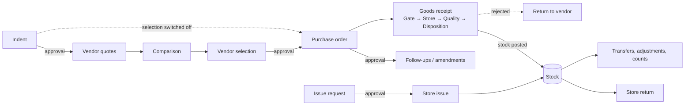

# User guide

How to get everyday work done: from asking for material to receiving, storing and issuing it. What you see depends on
your company's plan, settings and your permissions, so some buttons or menus below may not appear for you. Your
administrator can change that (see the [admin guide](admin-guide.md)).

## The big picture

Every step is a **document** with the same screens: a list, a detail page, an edit form and an approval screen.
Quantities flow from one document to the next and can be **partial** at every step: approve 80 of 100, order 50 now
and 30 later, receive in three deliveries, issue part of a request.

## Getting around

- **Sign in** at `/login` with your company code, email and password. On first sign-in you choose a new password
  (at least 10 characters with lowercase, uppercase and a digit; your company may require more).
- **Working location** (top bar): pick the plant, store or site you work for. Lists default to it; choose *All* to
  see every location you have access to.
- **Bell** (top bar): in-app notifications — approvals waiting for you, decisions on your documents, mentions,
  reminders, export downloads.
- **Profile menu**: theme (system, light, dark), your sessions (sign out other devices), sign out.
- **Dashboard** (`/dashboard`): your home page — approvals waiting, documents by status, and any charts your company
  set up for your role.

## Working with documents

### Lists: document-wise and item-wise

Each document type has a list (`/docs/<type>`), for example **Procurement → Indents**.

- **Document-wise** shows one row per document (number, date, location, status, total).
- **Item-wise** (`?view=item`) shows one row per line, with the quantity buckets of each line: requested, approved,
  held, rejected, cancelled, pending, and for later steps selected, ordered, received, issued. This is the view for
  "which items are still pending?".
- **Status chips** filter by status and show counts. You only see the statuses your role may see.
- Search (number, text, item), filter by location (includes sub-locations), date range and item; sort by a column.
- **Saved views**: save the current filters and columns, make one your default, or share it with roles (if allowed).
- **Export** the list to Excel or CSV (see [Reports and exports](#reports-and-exports)).

### Create, save and submit

1. **New** opens the form. Header fields first (location, dates, your company's fields), then the **lines** grid.
   Add, duplicate and delete lines; totals and formulas update as you type. Lookups (item, vendor …) search as you
   type, and cascades limit the choices (pick a category, then only its items).
2. **Save** keeps a draft. Drafts have no number yet and can be edited or deleted.
3. **Submit** checks the whole document (required fields, at least one line with quantity), assigns the number and
   starts the approval workflow. The document is then locked.

On the detail page you also find **Copy** (new draft with the same content), **Cancel** (whole document or chosen
lines, with a reason; cancels the quantity still pending), **Close**, **Print / PDF**, **Send** (email or WhatsApp),
and the tabs **Lines**, **Timeline** (every action, decision and change), **Comments** (type `@` to mention a
colleague; they are notified) and **Attachments**.

## Approvals

### Inbox

**Approvals** (`/approvals`) lists every document waiting for you, across all document types, with the stage, location,
submitter, amount, pending and held lines, and the due time. Filter by type and stage, or switch on **Overdue only**.
You see a document here because your role is an approver for that stage, because someone forwarded it to you, or
because it was escalated to you.

### Deciding

Open a document from the inbox (or **Approve** on its page). The approval screen lists each line with its **pending
quantity** at your stage. For each line choose how much to:

| Decision | Effect |
| --- | --- |
| **Approve** | Moves to the next stage (or becomes approved after the last stage) |
| **Hold** | Stays at your stage until you or a colleague un-holds it |
| **Reject** | Leaves the workflow |

Approve + hold + reject must equal the pending quantity. Typing a smaller approve quantity moves the rest to reject
(a **reduction**) and asks for a reason. Your company decides when a reason is required (usually reject, hold, send
back and reductions). Lines you do not touch stay pending. Some stages let you edit a line field while deciding
(for example the rate).

Keyboard: `j` / `k` (or arrows) move between lines, `a` / `h` / `r` put the whole pending quantity into approve / hold
/ reject, `s` leaves a line pending, `x` selects, `e` edits the approved quantity, `Enter` submits, `?` shows all
shortcuts. **Apply to all** sets the same decision on every selected line.

Other actions on the approval screen:

- **Un-hold** returns held lines to pending at your stage.
- **Send back** to an earlier stage, or to the creator as a draft (they edit and resubmit). Reason required.
- **Forward** the stage to a colleague with a reason; they can then act.

Some document types use **document-level** approval instead: one Approve / Hold / Reject for the whole document.

If two approvers act on the same document at once, the second one is told the document changed and the screen reloads
with your typed decisions kept where still valid. Pressing submit twice never records two decisions.

### What the status means

| Status | Meaning |
| --- | --- |
| Draft | Not submitted yet |
| Waiting for *stage* | Quantity is pending at that stage (the earliest one if several) |
| On hold | Only held quantity is left in the workflow |
| Partially approved | Some quantity approved, some rejected or reduced |
| Approved / Rejected | All quantity decided |
| Cancelled / Closed | Cancelled, or short-closed / closed |
| Being amended | A PO is being changed after approval |
| Partially received / Received | Goods received against a PO |

Stages can have a deadline (SLA). Approvers get reminders, and overdue stages are escalated to someone else. Overdue
items are flagged in the inbox and on the document.

## Procurement journey

### 1. Raise an indent

**Procurement → Indents → New**. Header: location (ship-to / requesting unit), date, required by, department,
priority, purpose. Lines: item, quantity, required date, remarks, attachments. Submit. The indent goes through its
verification workflow; approvers may approve part of a line, hold or reject.

### 2. Log vendor quotes

Once indent lines are approved, buyers open the indent's **Vendor quotes** tab (or **Quotes** on a line, also from the
item-wise list). For each line, **Add quote**: vendor, rate, currency, tax %, freight (lump sum or per unit), minimum
order quantity, lead time, valid until (defaults to your company's validity days), terms, notes, attachments.

- **Slabs**: rates that change with quantity (fixed rate, or a % off, from a quantity onwards). The form previews the
  rate for any quantity.
- **Also log for other open lines of this item** saves the same quote on several indent lines at once.
- Editing a quote saves a new version; earlier versions stay visible (**Show history**).

### 3. Compare

The **comparison sheet** puts vendors side by side for a line (or for all open lines of an item): quoted rate,
effective rate at the quantity (slabs applied), freight, tax, **landed cost** (your company's formula), total, lead
time, MOQ, validity and warnings (expired quote, quantity below MOQ …). The best value is marked and others show
"+x %" against it. Change the evaluation quantity to see slab effects. Rate history shows past orders of the item.

### 4. Select vendors

**Procurement → Select vendors** (`/procurement/select`) lists approved indent lines with quantity still to select,
grouped by item. Tick a line and allocate it to one or more vendors (vendor, quantity, rate); **Use best quote** fills
from the comparison, **Split across another vendor** adds a row. The meter shows allocated vs available. Selecting
more than approved needs special permission, a reason, and stays within your company's maximum %. **Save** as draft or
**Submit**; the vendor selection then follows its own approval.

If your company switched vendor selection off, skip this step: POs are created straight from approved indent lines.

### 5. Create purchase orders

**Procurement → Create PO** (`/procurement/order`) lists orderable lines (approved selection lines, or approved indent
lines when selection is off) with their pending quantity. Pick lines and quantities (for indent sources also vendor
and rate). The preview groups them by vendor — "Will create 3 purchase orders" — and **Create** makes one draft PO per
vendor. Two buyers can never order the same remaining quantity: the second gets a clear "quantity no longer available"
message.

On the PO draft, complete the header (payment terms, T&C, freight, other charges, discount, expected date) and lines
(rate, discount %, tax code, **delivery schedule**: dates and quantities that must add up to the line quantity). The
**Taxes** tab shows GST per line — CGST + SGST when the vendor is in the same state as the ship-to location, IGST
otherwise — and the totals. Submit for approval. If allowed, POs can also be created directly without an indent.

### 6. Follow up and amend

- **Follow-ups** tab: log each vendor contact (call, email, WhatsApp, visit), person, promised date and an optional
  revised expected date (with a reason). The history shows "12 Nov → 20 Nov (reason)".
- **Amend** an approved PO: give a reason; the PO becomes *Being amended* and editable (quantities, rates, schedules,
  terms, new lines; a line cannot go below what was already received). Resubmitting creates a new revision that goes
  through approval again; the **Revisions** tab shows a before/after diff per line. If the amendment is rejected the
  previous values are restored. You can also withdraw an amendment before resubmitting.
- **Short-close** a PO (or an indent) when the rest will not be needed: whole document or chosen lines, with a reason.
  The unreceived (or unordered) quantity is released.

## Goods receipt and the verification chain

### Receive goods (GRN)

**Stores → Receive** (`/stock/receive`) lists approved PO lines with quantity still to receive. Pick lines, enter the
received quantity (up to the pending quantity plus your company's tolerance), batch number, manufacturing and expiry
dates, and the header details (invoice number, date and amount, challan, vehicle, gate entry number, photos). This
creates a GRN (one per PO, or per vendor if allowed). Submit it.

A PO can be received in as many GRNs as needed; the PO shows *Partially received* until everything has arrived.

### The chain

The GRN then moves through your company's verification chain, line by line, with partial decisions at each stage.
The usual chain is:

1. **Gate entry check** — quantity rejected here is sent back at the gate; it never enters stock and the PO line
   re-opens for it.
2. **Store verification** — approving **posts the accepted quantity into stock** (available) at the receiving
   location, valued at the PO rate.
3. **Quality check** — only for items that need QC. Rejected quantity is **blocked** (moved to quarantine) and routed
   to disposition.
4. **Store disposition** — approve keeps the stock blocked (for rework); reject creates a draft **return to vendor**.

Your company may have a different chain; the stages you see on the document are the ones that apply.

### Return to vendor (RTV)

Rejected stock gets a draft RTV automatically from the disposition stage. To return accepted goods later, use
**Stores → Return to vendor** (`/stock/rtv`): pick GRN lines, quantity, the stock bucket to return from (available,
quarantine, rejected) and a reason. When the RTV is approved, the stock goes out and (if your company allows it) the PO
line re-opens for a replacement delivery. Print the debit note from the RTV.

## Stock

**Stores → Stock** (`/stock`) shows balances by item and location (optionally by batch): available, quarantine,
rejected, total, and value and average cost if you may see values. Filter by location (with sub-locations), item,
status, below-minimum or expiring within *n* days. Click an item for its summary per location, including open PO
quantity and pending issue quantity.

- **Ledger** (`/stock/ledger`): every movement with the running balance, linked to the source document.
- **Block / unblock**: move quantity between available and quarantine, with a reason.
- **Re-order** (`/stock/reorder`): items below their minimum with a suggested quantity, and the rules (minimum,
  re-order quantity, maximum, auto-indent). You are alerted when an item drops below its minimum.
- **Opening** (`/stock/opening`): enter starting balances (paste from a spreadsheet).

### Issue request, issue and return

1. **Issue request** (`/docs/issue_request`): a department asks the store for material — location, department,
   items, quantities, required date, purpose. It is approved like any document.
2. **Issue** (**Stores → Issue**, `/stock/issue`): the store keeper sees approved request lines with the quantity still
   to issue **and the available stock** at the issuing location, issues full or part quantities (batch where
   tracked) and submits; approval posts the issue out of stock. Several partial issues per request are fine. Direct
   issues without a request are possible if your company allows them.
3. **Return** (**Stores → Return**, `/stock/return`): return issued material from store-issue lines (up to issued minus
   already returned) into available or quarantine.

### Transfers, adjustments and counts

| Task | Where | What happens on approval |
| --- | --- | --- |
| **Stock transfer** | `/docs/stock_transfer` — from location, to location, items, quantities, batch | Stock moves out of the source and into the target, carrying its cost |
| **Stock adjustment** | `/docs/stock_adjustment` — item, location, batch, direction (in / out), quantity, rate for ins, reason | Stock is written on or off |
| **Stock count** | `/docs/stock_count` → **Snapshot**: pick a location; book quantities are frozen into a draft count. Open the **count sheet** (`/stock/count/<id>`), enter counted quantities; differences are highlighted. Submit. | Differences are posted as count in / count out |

Stock never goes below zero unless your company allows it; a movement that would is refused with the available
quantity shown.

## Partial quantities at a glance

Each line keeps a ledger of what happened to its quantity. On the detail page and in the item-wise list you can see:

| Bucket | Meaning |
| --- | --- |
| Requested | Submitted quantity |
| Approved / Held / Rejected | Workflow decisions so far |
| Cancelled / Short-closed | Taken out of the process |
| Pending | Still waiting in approval (includes held) |
| Selected | Allocated to vendors (indent) |
| Ordered | On POs (indent, selection) |
| Received / Accepted / Rejected at receipt | Goods receipts (PO lines) |
| Issued / Returned | Store issues and returns |

A line can be partly at one stage and partly at the next: the **stages** column on the detail page shows where each
part sits.

## Printing and sending

- **Print / PDF** renders the document with your company's layout (pick a layout if there are several). The PDF opens
  in a new tab when ready.
- **Send** emails or WhatsApps the document: choose the channel and template, recipients (the vendor's contact and
  suggested rules are pre-filled), attach the PDF, preview each recipient's message, then send. Email subject and body
  can be edited; WhatsApp uses approved templates only. The **Messages** tab shows delivery status (queued, sent,
  delivered, read, failed) and lets you retry a failed message.

## Reports and exports

- **Reports** (`/reports`): run a built-in or shared report, set its parameters (period presets or custom dates,
  location, other filters), expand grouped rows, follow drill-down links, see the chart. Parameters are kept in the
  page link, so you can bookmark or share the URL.
- **Export** any report, document list (document-wise or item-wise, with your current filters) or master list to
  **Excel (xlsx) or CSV**. Exports run in the background: you get a toast when it starts and a notification with the
  download link when it is ready. **Exports** (`/exports`) lists your recent exports; files are kept for 7 days.
- **Schedule** a report (daily, weekly, monthly or custom) if allowed; each run arrives in your notifications.
- **Build your own** report (if allowed): see the [admin guide](admin-guide.md#report-builder-and-dashboards).

Everything you export or report shows only the data you are allowed to see.
